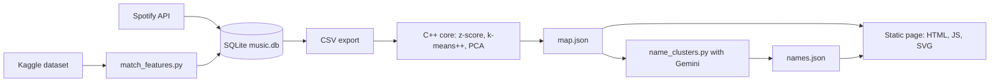

# Music Taste Map

Turns a Spotify playlist into a star map: tracks are stars, clusters are constellations, and the clustering math is written from scratch in C++.

[](https://github.com/STORM0090/music-taste-map/actions/workflows/ci.yml)


**Live demo:** https://storm0090.github.io/music-taste-map/ (a random sample of a public dataset, see [docs/DEMO.md](docs/DEMO.md))


## What it does

1. Fetches a Spotify playlist and stores the tracks in SQLite.
2. Fills the audio features (energy, valence, tempo, danceability and so on) from an offline dataset.
3. A C++ core normalizes the features, clusters the tracks with k-means++ and projects them to 2D with PCA.
4. A static page draws the result: one star per track, one color per cluster.
5. Optionally, an LLM gives each cluster a name and a one-line description.

## Highlights

- **Hand-written analytics, LLM only for names.** Z-score normalization, k-means++ and PCA (power iteration with deflation) are my own C++ code, written to understand the math and to be able to test every step. The core has no third-party dependencies, and a run takes about 50 ms for 250 tracks, so a library would not have bought speed. The LLM never decides which tracks belong together. It gets each cluster's profile (standout features, top genres, typical tracks) and returns a name and a sentence as schema-constrained JSON. The page works without names and falls back to "Cluster N".
- **Normalize before measuring distance.** Tempo is in beats per minute while most other features are between 0 and 1, so unscaled distances would be dominated by tempo. Features with zero variance are mapped to 0 instead of dividing by zero.
- **Seeded and tested.** k-means++ and PCA use a fixed RNG seed, so a run is repeatable and the algorithms can be unit tested (two runs must match).
- **Features from an offline dataset.** Spotify restricted the Audio Features endpoint for new apps from 27 Nov 2024, and my app received HTTP 403 from it. Tracks are matched to a Kaggle dataset by Spotify id first, then by normalized title and artist. Non-Latin titles normalize to an empty string, so they match by id only (an early version collided them all on one row).
- **SQLite as the cache.** Tracks are stored once and linked to playlists through a junction table. A re-fetch refreshes metadata but keeps matched features, and only tracks without features are matched again. I checked this with two overlapping synthetic playlists.

## Quick start

Look at the demo locally (no keys needed):

```sh
python -m http.server 8000 --directory docs
```

Open http://localhost:8000.

Build and test the C++ core (CMake 3.16 or newer, a C++17 compiler):

```sh
cmake -S cpp_core -B cpp_core/build
cmake --build cpp_core/build
cd cpp_core/build && ctest --output-on-failure
```

With a Visual Studio generator add `-C Debug` to `ctest`; the binaries are then in `cpp_core/build/Debug/`. Run the core on the bundled sample:

```sh
cpp_core/build/music_taste_core cpp_core/data/sample_tracks.csv 2 sample_map.json
```

Full pipeline for your own playlist. You need a Spotify app with the redirect URI `http://127.0.0.1:8888/callback`, the [Kaggle dataset](https://www.kaggle.com/datasets/anantsinghal786/almost-million-songs-dataset-2025-16-features) unpacked to `data/tracks.csv`, and, for names only, a Gemini API key from Google AI Studio.

```sh
pip install -r requirements.txt
cp .env.example .env            # fill in the keys
python get_playlist_features.py <playlist URL>
python match_features.py
python db.py export             # exports the latest fetched playlist
cpp_core/build/music_taste_core playlist_features.csv 5 web/map.json
python name_clusters.py         # optional
python -m http.server 8123 --directory web
```

On Windows, `update_map.bat` runs the pipeline for the playlist in `.env` and `view_map.bat` serves the finished map.

Tested on Windows 11 with Python 3.14.2, CMake 4.4.0, GCC 16.1.0 (MSYS2) and the Visual Studio 18 generator, spotipy 2.26.0, python-dotenv 1.2.2 and google-genai 2.11.0.

## How it works



| Part | Where | Role |
|---|---|---|
| Fetch and storage | `get_playlist_features.py`, `db.py` | Spotify API (authorization code flow) to SQLite and to the CSV the core reads |
| Feature matching | `match_features.py` | Fills missing audio features from the offline dataset |
| Analysis | `cpp_core/` | CSV loader, normalizer, distances, k-means++, PCA, JSON writer |
| Naming | `name_clusters.py` | One Gemini request per run, structured JSON output |
| Frontend | `web/`, `docs/` | `fetch` plus SVG, no framework. `docs/` is the GitHub Pages copy with demo data |

## Tests

`cpp_core/tests/test_core.cpp` has 68 checks in 6 groups: CSV loader, normalizer, distance metrics, k-means, PCA and JSON writer. It uses a small custom runner and is registered as a single ctest target, so ctest reports 1 test and the binary prints `68 checks, 0 failed`. The checks cover quoted fields, BOM and CRLF handling, malformed input errors, the z-score math, the zero-variance guard, cluster separation, PCA axis orthogonality and JSON escaping. The Python scripts and the frontend have no automated tests.

## Limitations

- **Coverage.** The offline dataset does not contain every track. On my own playlist 230 of 343 tracks (67%) matched, and the rest have no star.
- **11 features.** The dataset has no loudness, so it is not used.
- **2D is lossy.** Clustering runs on the 11 normalized features, not on the map. The two PCA axes explain 24.1% and 13.2% of the variance on the demo data, so distances on the map are approximate.
- **k-means.** k is chosen up front (the CLI prints inertia for k=2 to 8) and every track gets a cluster, so an outlier can form a tiny cluster. On my playlist one track did.
- **Repeatability.** A fixed seed gives the same result on the same build. The standard library's random distributions are implementation-defined, so other compilers may cluster differently (not tested).
- **LLM text.** Names and descriptions change between runs. They are labels, not analysis.
- **Platforms.** Developed and run on Windows. CI builds and tests the core on Ubuntu.
- **Two frontend copies.** `docs/` duplicates `web/`, so changes have to be copied by hand.

## Roadmap

- DBSCAN as a second clustering option, so outliers stay unlabeled.
- A librosa fallback for tracks missing from the offline dataset.
- Comparing the maps of several playlists (the schema already allows it).

Yehor Vorobiov
