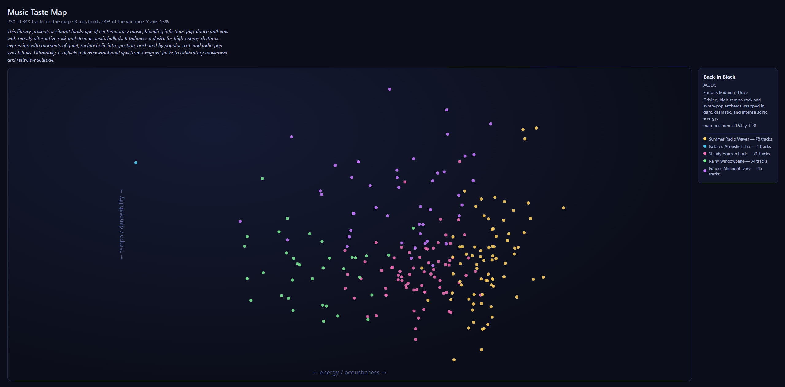

# Music Taste Map

Turns a Spotify playlist into a night-sky map of your music taste:
every track becomes a star, similar tracks cluster into constellations,
and an LLM gives each constellation an evocative name grounded in its
actual audio profile.



All the analytics — normalization, clustering, dimensionality
reduction — are implemented from scratch in C++. The AI does not
analyze anything: it only puts words on structure that is already
computed mathematically.

## Pipeline

```
Spotify Web API ──► SQLite (music.db) ──► CSV export
                        ▲                     │
   Kaggle dataset ──────┘ (offline           ▼
   (audio features)        feature      C++ core: z-score → k-means++
                           matching)         → PCA → map.json
                                              │
                    Gemini API ──► names.json ▼
                    (constellation      static web page
                     naming)            (vanilla JS + SVG)
```

| Stage | Tool | What happens |
|---|---|---|
| Fetch | `get_playlist_features.py` | Playlist tracks → SQLite, CSV export for the core |
| Enrich | `match_features.py` | Fills audio features from an offline dataset (Spotify closed its `/audio-features` endpoint for new apps in Nov 2024): exact track-id match first, then normalized name+artist fallback. Incremental — tracks matched once are reused for every future playlist |
| Analyze | `cpp_core` | Hand-written C++17: RFC 4180 CSV parser, z-score normalization, k-means with k-means++ seeding, PCA via power iteration, JSON export. Zero third-party dependencies, 68 unit tests |
| Name | `name_clusters.py` | Profiles each cluster (distinctive features, genres, typical tracks) and asks Gemini for names via structured outputs — guaranteed-valid JSON, one tiny free-tier request |
| View | `web/` | Static page, no frameworks: SVG stars colored by cluster, hover details, AI summary |

## Running it

Prerequisites: Python 3.10+, CMake + a C++17 compiler, a
[Spotify app](https://developer.spotify.com/dashboard) (add
`http://127.0.0.1:8888/callback` to its Redirect URIs), a free
[Gemini API key](https://aistudio.google.com/apikey), and an offline
audio-features dataset (any Kaggle Spotify dataset with `track_id` and
feature columns) unpacked to `data/tracks.csv`.

```sh
pip install -r requirements.txt
cp .env.example .env          # fill in your keys

cmake -S cpp_core -B cpp_core/build && cmake --build cpp_core/build

python get_playlist_features.py <playlist URL>
python match_features.py
python db.py export <playlist URL>
cpp_core/build/music_taste_core playlist_features.csv 5 web/map.json
python name_clusters.py

python -m http.server 8123 --directory web   # open http://localhost:8123
```

Tests: `cpp_core/build/music_taste_tests` (or `ctest` in the build dir).

On Windows, two shortcuts wrap the above: `view_map.bat` serves the
already-generated map and opens the browser; `update_map.bat` re-runs
the whole pipeline for the playlist from `.env` (or pass one as an
argument).

## Engineering notes

- **Why normalize:** features live in wildly different ranges (tempo
  50–200 vs danceability 0–1); without z-scores any distance metric is
  dominated by tempo alone.
- **k-means++ and determinism:** spread-out seeding avoids poor local
  optima; a fixed RNG seed makes every run reproducible bit-for-bit,
  which is also what makes the algorithms unit-testable.
- **PCA by power iteration:** the 2D star-map projection is computed
  from the covariance matrix with power iteration + deflation — ~150
  lines instead of a linear-algebra dependency, and the axes stay
  interpretable (for my library: energy↔acousticness vs
  tempo↔danceability).
- **Data honesty:** one track renders with a garbled artist name.
  That's not a pipeline bug — Spotify's own catalog serves those bytes
  (verified against the API directly; Cyrillic titles in the same file
  survive intact). The pipeline faithfully preserves its source.
- **The lone-star cluster:** k-means must assign every point somewhere,
  so a single Japanese instrumental outlier gets a cluster of its own —
  a nice argument for trying DBSCAN next.

## Roadmap

- DBSCAN as a second clustering backend (outliers become "unnamed stars")
- librosa fallback for tracks the offline dataset misses
- Compare taste maps of different people (schema already supports
  multiple playlists)

## License

MIT
